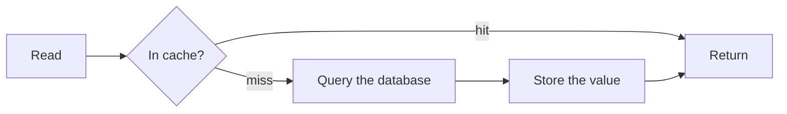

**The alix deck-authoring guide**

This file is the one source for how to write an alix deck. Hand the part
between the `guide` anchor lines to an outside AI (a chat assistant or a
coding agent) together with your source material, and ask it for a deck.
`alix deck guide` prints that part, matching the alix version that will
validate the deck. The part has six anchored pieces: `format` (with the
nested `card-rules`), `shapes`, `diagrams`, `practice`, `workflow` and
`sources`. The book and the deck generator include some of them by name.
Everything between the anchors is written for a reader who knows nothing
else about alix, so it carries no headings that a deck parser could mistake
for a topic or a card.

<!-- ANCHOR: guide -->
<!-- ANCHOR: format -->
**What you are writing.** An alix deck is one Markdown file of flashcards
that the alix app schedules for spaced repetition. alix decides what each
line is from where it stands and how it starts, so the layouts below are
exact: a line in the wrong place is an error, or worse, silently a
different kind of card. The file holds only the deck, with nothing before
or after it. How you hand it over follows the request you were given.

**Frontmatter.** The file opens with a YAML block between two `---` lines.
Write `title:` (the deck's name). Optional keys: `description:` (one line),
`authors:` (a list naming the people and any AI that helped), `license:`,
`created-at:`, `link:` (a web page the in-app tutor, an AI the learner can
question about a card, may consult; the exam, an AI test of the
learner's understanding, ignores it), and deck-wide
defaults for the card keys below: `choices: single` (every task list is a
choice card, so the per-card line may be left out), `reveal: line`,
`direction: both`, `input: draw`, `review: sequential` (serve the cards in
file order instead of by schedule) and `sampling: off` (a card table's
rows stop serving as each other's wrong options; see card tables).
Never write an `id:` key. Any other key draws a warning and is ignored.

**Topics.** A line starting with `# ` (one hash, a space, a title) opens a
topic: a section of the deck. The heading and the prose paragraphs under it
are the shared context of every card below, until the next `# ` line. The
learner opens that context on demand; it is never shown while answering.
alix accepts a deck without topics (it then counts as one topic), but this
guide asks you to use them. The body must start with a heading (`# ` or
`## `): text before the first heading is an error.

**Cards.** A line starting with `## ` at column 0 starts a card, and the
rest of that line is the front (the question). The plain lines directly
below it are the answer: at least one line. Do not start an answer line
with a bullet or dash; the `- [x]` options of a choice card are the one
list allowed. Leave one blank line between cards. Do not start any line
with `###` or more hashes:
that makes a sub-card, held back from review until the card above is
learned.

**A front longer than one line.** Put the extra front lines (code, a second
sentence) under the `## ` line, then a blank line, then a line holding only
`---`, then the answer. A one-line front needs no `---`.

**Notes.** A note is shown after the learner answers and is never tested.
It is a blockquote whose first line is exactly `> [!NOTE]`, with its body on
`> ` lines below. It comes last in the card. `[!TIP]`, `[!IMPORTANT]`,
`[!WARNING]` and `[!CAUTION]` badge lines also make notes there. A
blockquote without one of these badge lines is a quotation: it belongs to
the answer and reveals with it.

**Hints.** A `> [!TIP]` block between the front and the `---` line is a
hint instead of a note: offered while the learner answers, and a review in
which the learner opened it counts as at best partly right. A card with a
hint always has the `---` line, with a blank line above it. The order is
then: front, hint, a blank line, `---`, answer, note.

**Comment lines.** Every `<!-- ... -->` line is alix machinery, never
prose. Each sits on its own line directly below the block it belongs to
(the last answer line, the last option, the last table row, or a cloze
card's sentence), with no blank line between, and above the card's note.
Several comment lines stack directly below one another. Write only the
comments this guide shows, unless the request you were given asks for
others.

**Text inside cards.** `**bold**`, `*italic*`, inline `` `code` ``, fenced
code blocks, and `$...$` math work. A `*` meant literally goes in backticks
or is escaped as `\*`; `alix doctor` reports text that will render as
emphasis. An image is `` alone on its own line.

**Escaping.** An answer line that must start with `#` (any number of
them), `>`, `---`, `<!--` or a code fence is written with a leading
backslash (`\## Title`), which alix removes on display. Inside a fenced
code block nothing needs escaping.

**Terms used below.** Recognize is the review depth where the learner picks
the answer from options; the options come from a choice card's
distractors, from the other rows of a card table, or from AI-written
distractors alix adds later. A directive is a `<!-- key: value -->` comment
line. An invocation is the comment that turns the block above it into
cards: `<!-- cards -->`, `<!-- choices: single -->` or
`<!-- choices: multiple -->`.

**Every card kind by example.** A deck with frontmatter, one topic, and one
plain card with a note:

```
---
title: Rust ownership
description: Who frees a value, and when.
authors: [Ada Learner, an AI assistant]
---

# Ownership

Rust frees memory without a garbage collector. Every value has exactly one
owner, a variable, and the compiler tracks where that owner's life ends.

## What happens to a value when its owner goes out of scope?
It is dropped, and its memory is freed.
> [!NOTE]
> The compiler inserts the drop call; no runtime collector runs.
```

A plain card whose front has two lines (the question, then the call it
asks about) and a hint; the `---` line separates front from answer:

```
## What does `lo` control in this call?
bisect_right(a, x, lo=0)
> [!TIP]
> Think of where the search starts.

---
The lowest index the search considers.
```

A cloze card hides one span of the sentence on its own `## ` line.
A cloze card has no answer section: no answer lines and no `---`. Each
`<!-- blank: span hidden="..." -->` line makes one card that asks that
span, so two lines on one sentence make two cards asking different words.
If the hidden text occurs more than once in the sentence, add
`occurrence=2` (counted from 1) to pick which, as in
`<!-- blank: span hidden="ACK" occurrence=2 -->`. A note goes below the blank
lines. A cloze card is never reversed: `direction:` on one is an error.

```
## A value is dropped when its owner goes out of scope.
<!-- blank: span hidden="dropped" -->
> [!NOTE]
> Dropping runs the value's cleanup code and frees its memory.
```

A choice card: one `- [x]` answer and two or three `- [ ]` distractors,
then `<!-- choices: single -->` directly below the last option. Without
that line (or `choices: single` in the frontmatter) the list stays a plain
checklist, and `alix doctor` does not report it. The note explains the
distractors and may also say why the answer is right.

```
## Which keyword makes a Rust binding mutable?
- [ ] var
- [x] mut
- [ ] ref
- [ ] static
<!-- choices: single -->
> [!NOTE]
> var: a JavaScript habit; Rust has no var.
> ref: binds by reference, which says nothing about mutation.
> static: declares a global item, not a mutable local.
```

A select-all choice card: a `- [x]` on every correct option, closed by
`<!-- choices: multiple -->`. The same warning applies: without that line
it is a plain checklist. On either kind, a `direction:`, `reveal:` or
`input:` line below the invocation is ignored without a warning.

```
## Which of these are Rust integer types?
- [x] u8
- [x] i64
- [ ] f32
- [ ] char
<!-- choices: multiple -->
> [!NOTE]
> f32: a number type, but floating point.
> char: stored as a number, but a Unicode scalar, not an integer type.
```

A card table: every row is one card (first column front, second back,
optional third column a note), with `<!-- cards -->` on the line directly
below the last row. The header row is never shown, so its names are free;
it has as many cells as the table has columns, two or three. Column widths
need not line up. A `## ` line directly above the table, with no answer
lines of its own, is the question every row asks, so under
`direction: both` it must make sense both ways. Without that line, each
row's front is its first cell alone. Other directives for all
rows go on their own lines below `<!-- cards -->`, as `sampling: off` does
for a table whose rows are not alike enough to serve as each other's wrong
options.

```
## Give the word in the other language
| front | back | note |
| --- | --- | --- |
| purported | angeblich | common in legal text |
| feasible | machbar | |
| tedious | mühsam | |
| to refute | widerlegen | |
<!-- cards -->
<!-- direction: both -->
```

Three plain cards, each with one modifier: `<!-- reveal: line -->`
uncovers and grades the answer one line at a time, `<!-- direction: both -->`
also asks the card reversed (answer to front, a second card), and
`<!-- input: draw -->` gives the learner a sketch canvas instead of a text
field; the answer lines are what the learner compares the sketch with.
These modifiers work on plain cards and card tables.

```
## Name the steps of the TCP handshake, in order.
SYN
SYN-ACK
ACK
<!-- reveal: line -->

## purported
angeblich
<!-- direction: both -->

## Sketch the shape of a binary heap of seven keys.
A complete binary tree of three levels, each parent no larger than its children.
<!-- input: draw -->
```

<!-- ANCHOR: card-rules -->
Rules that hold whatever the shape:

- Every card except a cloze card needs at least one answer line.
- Most cards deserve a `> [!NOTE]` note: an example, a caveat, a mnemonic,
  or why it matters. Never a restatement of the answer. The badge line is
  required; a blockquote without one is a quotation and belongs to the
  answer. A card table is the exception.
  A card table's note is that column, and a blockquote below a table does
  not parse at all.
- A choice card's note names the option's claim or mistaken premise, never
  its number, letter, or screen position. Options shuffle between
  appearances.
- Every `<!-- ... -->` line trails its card: it goes directly below the
  block it belongs to, with no blank line between them, and never above an
  answer line, an option list, or a table. It sits above the card's note;
  a key such as `reveal:` or `direction:` also works below the note, but an
  invocation or a `blank:` line there fails.
- An invocation binds the block directly above it, so it sits on the line
  immediately below the last option or row. `<!-- cards -->` takes card
  directives after it (`direction:`, `reveal:`, `sampling:`, or an `at:`
  locator in the form the request gives, when the request you were given
  asks for one), but never a
  blockquote. `<!-- choices: single -->` and `<!-- choices: multiple -->`
  take a `> [!NOTE]` note after them.
- One idea per card. Split compound facts rather than nesting them.
- No two cards may test the same fact. Vary what is asked; do not
  rephrase.
<!-- ANCHOR_END: card-rules -->
<!-- ANCHOR_END: format -->
<!-- ANCHOR: shapes -->
Which card shape suits which material. Read the material first, then
pick the shape; do not pick a shape and bend the material into it.
**Structural** rows: the material has a property the shape exploits, and
any other shape wastes it. **Judgement** rows: more than one shape is
defensible and the choice is yours.

| material | shape | kind | why |
| --- | --- | --- | --- |
| Paired items: a word and its meaning, a term and its definition, a symbol and its name. | A card table: a GitHub pipe table with `<!-- cards -->` on the line directly below the last row, no blank line between, one row per pair, columns front, back, and an optional note. | structural | One row per pair, and each row's Recognize options come from its own column, so the wrong answers are real siblings and cost no AI call. Prose wastes both. |
| Ordered steps in one straight line, reproduced in order: a recipe, an algorithm, a verse. | `reveal: line`, with one step per answer line. | structural | Order is graded, and the answer uncovers one line at a time so recall is stepwise rather than all-or-nothing. A flip card cannot test order at all. |
<!-- ANCHOR: shapes-diagram-row -->
| A process that branches or sends work back to an earlier step, a lifecycle, an exchange between several parties. | A diagram in the card's front, with a question about one relation in it (see Diagrams below). | structural | A branch or a way back has no single order for `reveal: line` to grade. The picture holds the whole flow, and the question picks one path through it. |
<!-- ANCHOR_END: shapes-diagram-row -->
| An answer that cannot be typed: a diagram, a circuit, a glyph, notation. | `input: draw` | structural | The learner sketches and self-grades against the reveal. Typing a diagram is not a check, it is a workaround. |
| A statement turning on one term, where the sentence around it is the cue. | Cloze: write the whole sentence on the `## ` line and hide the span with `<!-- blank: span hidden="..." -->` on its own line directly below it, above any note. A cloze card has no answer lines and no `---`. | judgement | The context does the cueing, so recall is anchored where it will be used. If nothing in the sentence is a natural target, this is a plain card wearing a disguise. |
| A fact whose common confusions are known and nameable. | Authored choice: a task list with one `- [x]` and two or three `- [ ]`, closed by `<!-- choices: single -->` on the line directly below the last option (or `choices: single` in frontmatter, once for the deck). | judgement | The distractors are the teaching. Write them only if you can say what mistaken belief each one represents; if you cannot, the shape is doing nothing. |
| Several items that share a property, out of a set where the rest do not: which of these are X, which statements are false. | Select-all: a task list with a `- [x]` on every correct option and a `- [ ]` on every other, closed by `<!-- choices: multiple -->` on the line directly below the last option. | judgement | Only the exact set passes, so every option is judged on its own; a single-answer card lets the learner stop at the first match. Use it when several answers are genuinely correct, not to pad a one-answer question. |
| A term that must be recalled from either side: vocabulary, symbols, names. | `direction: both` | judgement | One authoring act, two cards. Reach for it when both directions are genuinely useful, not by default: it doubles the review load. |
| Anything else: a definition, an explanation, a cause, a comparison. | A plain card: `## ` front, answer lines below. | judgement | The default, and not a failure. Most material has no structure to exploit, and a plain card drilled well beats a clever shape drilled badly. |

`review:` and `sampling:` are not shapes: they change how a deck is
served, not what a card asks.
<!-- ANCHOR_END: shapes -->
<!-- ANCHOR: diagrams -->
**Diagrams.** A fenced code block whose info string is `mermaid` holds a
diagram. alix draws it as a picture only in a deck inside a workspace (a
folder alix manages, created with `alix workspace init`), on
a machine where the optional `sekien` renderer, a separate program, is
installed; everywhere else the learner sees the fence as a code block. You
need not know which the learner gets: write each fence so it
also reads sensibly as source text. Material that describes a process
with a branch or a way back, a lifecycle, or an exchange between parties
gets at least one diagram card, besides its other cards; other material
gets a diagram only where a picture teaches a relation better than text.
One branch or one way back is enough; steps in one line with neither suit
`reveal: line` instead.

- Draw only steps and arrows the source states. Add no step, order or
  branch of your own.

- Pick the diagram type by the material: a flowchart for a process or a
  decision, a sequence diagram for an exchange between parties over time,
  a state diagram for a lifecycle, a class or ER diagram for structure, a
  timeline for dated order. A mindmap only shows hierarchy; prefer prose.
- Keep it small enough to read on a phone screen, with few crossing
  edges. Split a bigger process across several cards.
- Labels sit on their nodes. No decorative nodes or colors.
- Ask about relations ("what happens after X", "why does X lead to Y")
  more often than about a single label.

A diagram in a multi-line front, above the `---` line:

````
## Why does a cache hit never reach the database in this read path?


---
The cache already holds the value, so the read returns it without a query.
> [!NOTE]
> Only a miss pays for the database round trip, so the hit rate sets most of the read latency.
````

A masked label: the card shows the diagram with one label hidden and asks
for it. This is the one exception to the cloze rules above: the `## ` line
is a question rather than the sentence, the fence sits below it, and the
`<!-- blank: span hidden="..." -->` line goes directly below the closing
fence. Like a cloze card, it needs no answer line. A card may hide one
label this way. The hidden text must be one
complete visible label, never a label split by `<br/>`.

````
## Name the hidden step of a cache read.

<!-- blank: span hidden="Store the value" -->
````
<!-- ANCHOR_END: diagrams -->
<!-- ANCHOR: practice -->
**Topic prose is for a reader who knows nothing yet.** Group the cards
under `# ` topics, one per coherent part of the material. Under each
heading write a short paragraph, the way a textbook paragraph precedes its
exercises: what the thing is, why it exists, the words the cards will use,
and the problem the cards below resolve. Pose the problem and stop; never
state an answer a card asks for: "two threads can update one counter at
once" poses the problem, "so a lock guards it" states the answer. A bare
heading is not context, and neither
is a list of the subjects the cards touch. The heading itself is a short
phrase naming what its cards cover, not the deck's title. A deck of a few
cards takes one topic; a long deck takes one per group of related cards.

**Make the learner think.**

- Every card makes the learner produce or pick an answer. Write no card
  that only shows information.
- Cover the material at four levels: facts and terms, mechanisms (why and
  how), application, and connections between ideas. Order cards from
  foundational to advanced.
- Give each important idea two or more cards from different angles: its
  cause, how it differs from a neighbour, what it does in a case. An angle
  is not a rephrasing: each angle has a different answer (see the revise
  pass below).
- Each important idea also gets at least one card that applies it to a new
  concrete case or asks to predict an outcome, besides any definition
  card. The case may be new; the rule it applies and its answer follow
  from the source. The answer is an outcome or a decision, never the name
  a definition card already asks for.
- For two ideas a learner could confuse, write a card asking how they
  differ.
- For a surprising fact, ask for a prediction before the reveal.
- For a procedure, give one card whose front walks through a worked
  example and asks for its last step.
- Choose each card's shape from the material, as the shape table says,
  never to vary the deck.

**Fronts and answers.**

- One idea per card. The answer must cover exactly what the front asks;
  move anything extra into the note, or split the card.
- One expected answer per front. Name the scope (which version, which
  case) when the answer would otherwise be ambiguous.
- Cards are answerable from memory but not trivial. A hint may make a
  hard card answerable, never guessable.
- No yes/no or true/false fronts, and never let the layout hint at the
  answer (such as how many items it has).
- A list of several items becomes several cards, one per item. Keep a list
  as one card only when its order is the thing to learn, with one item per
  answer line and `<!-- reveal: line -->`.
- Write in your own words, grounded in the source. Invent no fact the
  source does not support.
- A note explains why the answer holds, or how it connects to another
  idea; on a choice card, why each distractor is wrong.

**When a card is a choice card.** It has two or three distractors, each a
mistaken belief a learner could really hold. Every distractor is:

- tempting to someone who only half knows the material;
- matched to the correct answer's form and length (a year competes with
  years, a command with commands);
- clearly incorrect, never a synonym or restatement of the answer;
- distinct from the other options.

These give the answer away, so reject them: absolutes ("only", "always",
"never"), hedges and minimizers ("cosmetic", "merely", "just",
"sufficient"), absurd claims, an option far more or less specific than the
rest, and the negation of the correct answer, which includes a flipped
value (0 for 1, true for false). If you cannot say what mistaken belief a
distractor represents, use a plain card instead. The card's note names each
distractor by its content and states the mistaken premise behind it, not
just that it is wrong.

**Revise before finishing.** Re-read the whole deck as a set. Write each
card's answer in a few words beside it. Two cards with the same answer
test the same fact, whatever their fronts say, and the same answer in
other words is the same answer: merge or delete one. A select-all card
tests each of its options. Two cards whose answers differ are two angles,
not a repeat, even when they concern one idea. Two answers differ when a
learner who knows one could still miss the other. The repeat that slips
through is a case card whose answer is the fact another card already asks:
"how long is the wait?" (48 hours), then a case that ends in "the full 48
hours". Delete the plain fact card and keep the case, or change the case
until its answer is one no other card has. A shorter deck without
repeats is better than a long one with them.

**Self-check before you hand it over.**

- The file's first line is the `---` that opens the frontmatter, and
  nothing follows the last card.
- Every `<!-- ... -->` line has its block directly above it. None sits
  between a `## ` line and its answer, and none is written twice.
- No `<` directly followed by a letter outside inline code or a fenced
  code block, in fronts, answers, notes and topic prose alike, math
  included: write `` `Vec<u8>` `` or `` `Box<dyn Any>` `` in backticks, and
  `$a < b$` with a space.
<!-- ANCHOR_END: practice -->
<!-- ANCHOR: workflow -->
**Write no ids.** alix gives the deck, every topic and every card a
permanent id when the deck is initialized, and the learner's review history
hangs on those ids. Write no `id:` key and no `<!-- id: ... -->` line, and
never invent one: alix keeps a made-up id without complaint, and a copied
one can collide with another deck. When you edit a deck that already has
such lines, keep them exactly as they are.

**Where the file goes.** A deck the learner wants examined (see sources
below) must live in a workspace, a folder alix manages; any other deck may
sit anywhere.

**Check it.** Run these steps if you can run commands; otherwise give them
to the learner.

1. For an examined deck: `alix workspace init <dir>` creates the workspace
   folder (or turns an existing folder into one). Save the deck as
   `<dir>/decks/<name>.md`, directly in `decks/`: a deck in a subfolder of
   it is not part of the workspace.
2. `alix deck init <file>` initializes the deck and writes its ids. If the
   deck does not parse, it refuses and names the line to fix.
3. `alix doctor <file>` checks the deck. Fix everything it prints as
   `error:` or `warning:`, and run it again until it prints neither. A
   warning naming `sekien` means diagrams are not frozen on this machine
   and may stay.
4. Check by eye what no command catches: every task list meant as a choice
   card has its `<!-- choices: single -->` or `<!-- choices: multiple -->`
   line; every note starts with a badge line such as `> [!NOTE]`; no answer
   line starts with a bullet.
<!-- ANCHOR_END: workflow -->
<!-- ANCHOR: sources -->
**Sources for the exam.** The exam is alix's test of understanding: an AI
writes open questions from the deck's source files and grades the
learner's typed answers against them, and passing it marks the deck done.
Sources are attached by command after `alix deck init`, never written into
the deck: there is no frontmatter key for them. Only a workspace deck can
have sources, and a deck without sources has no exam.

**Each source grounds topics.** The exam goes topic by topic; a topic with
no source is not examined. A deck without `# ` topics is one topic.
`alix deck source list <deck>` prints every topic's id next to its heading; a
unique prefix of an id is enough. Then:

```sh
alix deck source add <deck> <file> --root <key>=<dir> --topic <topic-id>
```

`<deck>` is the deck's file and `<file>` the source's path. `<dir>` is a
folder that contains `<file>`, saved for that deck under
`<key>`, a short lowercase name such as `notes`; the deck's later files
under that folder need no `--root`. `--topic` takes one or more topic ids,
separated by spaces. To bind only some lines, write
`--topic '10-80,120|<topic-id>'`: line numbers counted from 1, a range
inclusive, a single number one line, ascending and not overlapping, quoted
because `|` means something to the shell. Each id takes its own lines,
and ranged and plain ids mix: `--topic '1-5|<id-a>' '10-20|<id-b>' <id-c>`.
A deck without `# ` topics omits
`--topic`. A source must be a local UTF-8 text file; to use a web page,
save it as a file first.

**Keep each topic within the AI backend's limit.** The backend is the AI
command-line tool alix calls. Every exam call carries a topic's sources
whole, and each backend refuses a prompt past its own limit.
`alix deck source list <deck>` shows each sourced topic's size against every backend's
limit and marks the ones it exceeds; if you cannot run it, give the
learner this step. To fix one, split the topic into two
`# ` topics, or bind only the lines the topic needs.

**What to tell the learner.** If the learner asks which files and line
ranges each topic rests on and you cannot run the commands, list them
separately from the deck file.
<!-- ANCHOR_END: sources -->
<!-- ANCHOR_END: guide -->
